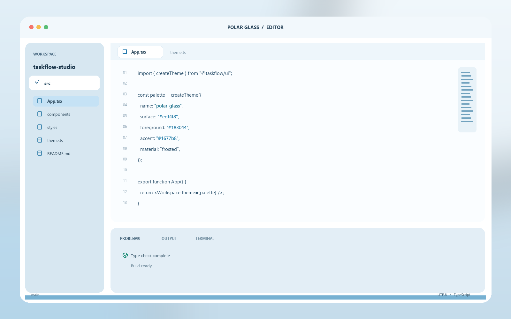
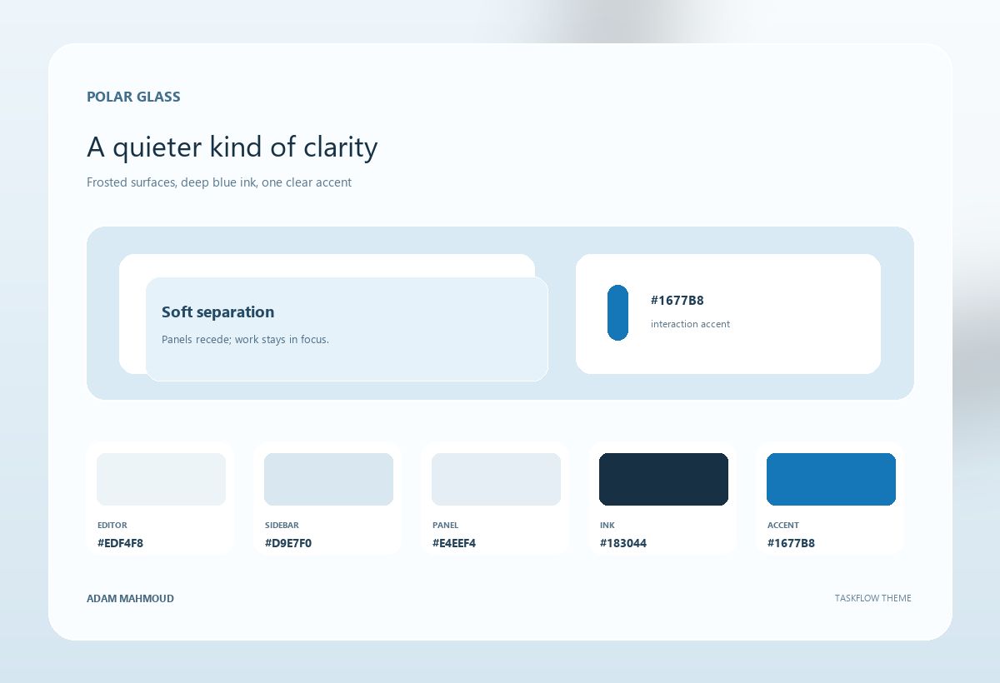

# Polar Glass

**Publisher:** ADAM MAHMOUD

**Style:** Cool, translucent surfaces with deep blue ink and a clear sky-blue accent.

Polar Glass treats the editor as a quiet instrument: a pale glacial field holds the work, while layered panes suggest light passing through etched glass. Space stays open around the code; panels recede instead of competing for attention.

The palette pairs frosted blue-grey surfaces with ink-dark text, then reserves a precise blue for links and active details. The glass effect softens the sidebars and panels, while the editor remains calm and legible.

The composition is intentionally restrained. Rounded, translucent surfaces are balanced by crisp text and fine boundaries, with color used to guide the eye rather than decorate every control. The result should feel carefully calibrated, not ornamental.

Every tone is chosen for contrast and hierarchy: the cold background separates work areas, the darker foreground anchors reading, and the sky accent marks interaction. The finish is meticulous but leaves the code itself as the focus.

## Install

Open **Appearance** in the AI TaskFlow editor, find **Polar Glass**, and choose **Install**. Use **Reset** in Appearance to restore the editor's original appearance.

The preview images are visual references. This theme changes the editor, sidebar, panel, foreground, and accent colors supported by TaskFlow; it does not change syntax-highlighting rules.

## Preview

